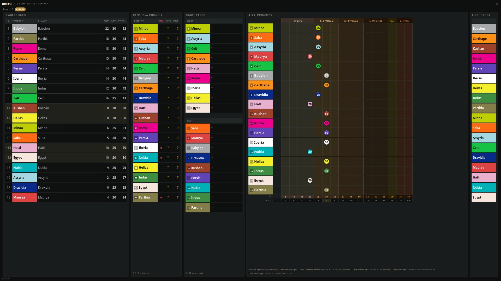
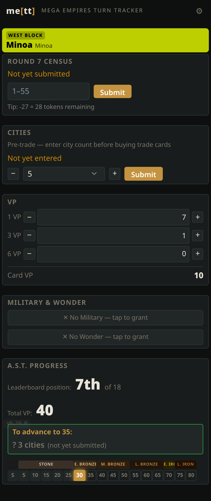
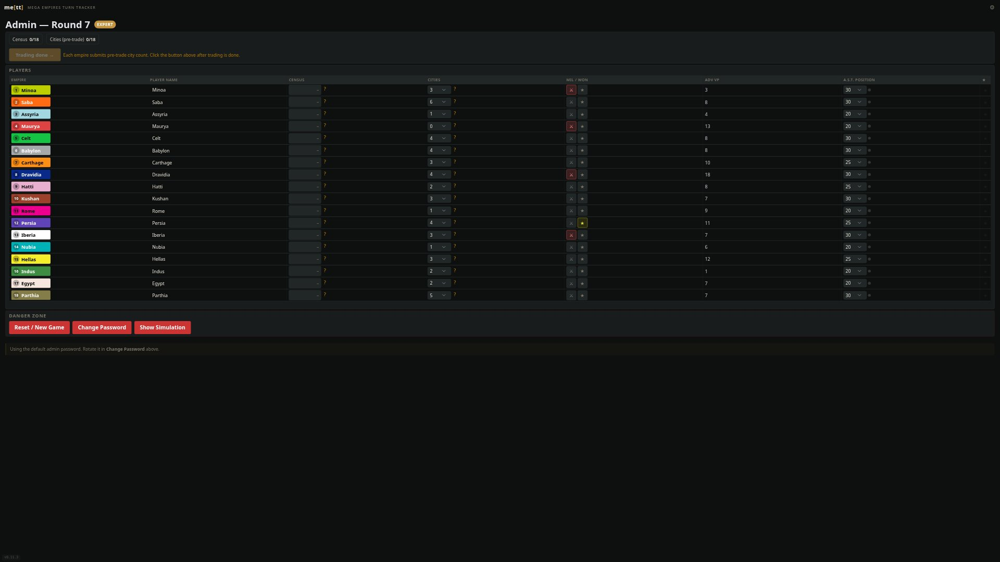

# me[tt] — Mega Empires Turn Tracker

**me[tt]** keeps the books for **Mega Empires: The West & The East**, the 3–18 player board game that runs over a long weekend. One shared screen shows the whole table (census and move order, trade cards, A.S.T. progress, the leaderboard), and every player updates their own empire from their phone. It is made out of love for the game, free and always will be, so the people around the table can spend their time on Mega Empires, not on the bookkeeping.

If me[tt] has saved your table some time, you can [buy me a coffee on Ko-fi](https://ko-fi.com/nilsan). It is never expected, and always appreciated.

**Try it:** [demo.mett.games](https://demo.mett.games) is a 12-empire game in round 7. Open it on a big screen, open an empire's page such as [demo.mett.games/rome](https://demo.mett.games/rome) on your phone, and play. The admin page is at [/admin](https://demo.mett.games/admin) (password `demo`). Every night at 03:00 UTC the demo starts over from the same game, whatever visitors did to it.



---

## What it does

- **Census and move order.** Each player enters their population on their phone. The board shows who is still missing and reveals everything at once when the last census is in, sorted into move order (Military holders last).
- **Trade cards.** Players enter their city count; the board shows each empire's trade-card draw, West and East side by side.
- **A.S.T.** At the end of the round me[tt] moves every empire on the Archaeological Succession Table by the official requirements for Basic or Expert, including slow-start empires, the Wonder (+1 city), and Expert regression with no cities. Each player's page shows exactly what they still need for the next step.
- **Calamities.** Cities are counted again after calamities; the game master can knock an empire back a step, and the board marks it.
- **Leaderboard and the end of the game.** Live ranking by victory points, the Late Iron Age bonus, the Expert final round, final scoring with tie-breaks.
- **Live everywhere.** Every screen updates instantly; nothing to refresh. The status board keeps the TV awake and has a full-screen button.
- **Safety net.** A backup is taken before every round advance; the game master can undo an advance or restore any backup from the admin page.

The rules me[tt] implements, and where it simplifies, are in [RULES.md](RULES.md).

**Planning advance purchases:** use Matt Crawford's [Mega Empires Calculator](https://calculator.mega-empires.com/) alongside me[tt]; it makes buying decisions much easier.

---

## The three screens

**Status board** (`/`) — the shared screen or TV. Built for 1920×1080 and up (including 4K TVs); it never scrolls. On a phone it shows the same tables one under the other.

**Player page** (`/<empire>`, e.g. `/egypt`) — each player bookmarks their own. Census, city count, advance cards, Military / Wonder / special ability, and the A.S.T. requirements with what is still missing in red.



**Admin** (`/admin`) — the game master's page: set up the game, see every empire, fill in for a player who is away, run the phases, undo, restore. Works on a laptop or a phone.



---

## Run your own

You need a Linux server with Docker and a domain name pointing at it.

```bash
git clone https://github.com/nilsan/mett.git
cd mett
# Put your own hostname in docker/Caddyfile (it says demo.mett.games)
docker compose -f docker/docker-compose.yml up -d
```

Caddy fetches the HTTPS certificate on the first visit. Open `https://<your host>/admin` and log in with **`PASSWORD`** (or set `ADMIN_PASSWORD` in the compose file before the first start), then change it from the admin page.

- **Updates:** `docker compose -f docker/docker-compose.yml pull && docker compose -f docker/docker-compose.yml up -d`. Images are published only after the full test suite passes. Set `METT_VERSION=1` to get every compatible update and nothing that needs manual work ([how versions work](DEV.md#versioning)).
- **Data:** the game and its backups live in the `mett_data` volume.
- **Several tables:** one me[tt] instance runs one game. Add a service and a Caddyfile block per table (e.g. `east.example.com`, `west.example.com`).
- **No server?** For a single weekend on a home network, run it on a laptop with [Bun](https://bun.sh): `bun install && bun run src/index.ts`, then open `http://<laptop IP>:3000` on the other devices.

---

## Playing a game with me[tt]

1. **Set up** on `/admin`: Expert or Basic, number of players, **Apply recommended civs** (the official scenario table), player names, **Start Game**.
2. Put `/` on the shared screen; every player opens their empire's page.
3. **Census:** everyone enters their population. The move order appears when the last one is in. A player without a phone? The game master types it in on the admin page.
4. **Trade:** everyone enters their city count; the trade cards appear on the board. When trading is done, the game master clicks **Trading done → recount**.
5. **Calamities:** resolve them at the table, then everyone enters their city count again. The game master applies any A.S.T. regressions and clicks **Advance**.
6. me[tt] moves the A.S.T. markers, and the next round starts. Players update their advance cards whenever they buy.

The game ends by itself: in Basic when an empire reaches Late Iron Age, in Expert one round later. The board then shows the final scores; ties are broken by the rules, and any tie the rules can't break is settled on the admin page.

---

## Contributing

Bug reports and ideas are welcome as [issues](https://github.com/nilsan/mett/issues). For code, see [CONTRIBUTING.md](CONTRIBUTING.md) and [DEV.md](DEV.md) (setup, architecture, API, tests). Changes are listed in [CHANGELOG.md](CHANGELOG.md).

Built with [Bun](https://bun.sh), [Hono](https://hono.dev), TypeScript, SQLite, [htmx](https://htmx.org) and [Pico CSS](https://picocss.com), and written together with [Claude](https://claude.com/product/claude-code), Anthropic's AI, in Claude Code: I decide what me[tt] should do and how it should look, test it at real tables, and Claude writes most of the code and the tests.

---

## License

**Mozilla Public License 2.0** — Copyright © 2026 [Nils-Anders Nøttseter](https://github.com/nilsan). Full text in [LICENSE](LICENSE). You can use me[tt] in your own work; changes to me[tt]'s own files stay under the MPL.

Inspired by the original [METool](https://github.com/roenoe/METool) by Roe Nøttseter. Mega Empires is a game by Flo de Haan and Gerart de Haan; me[tt] is an unofficial fan project.
